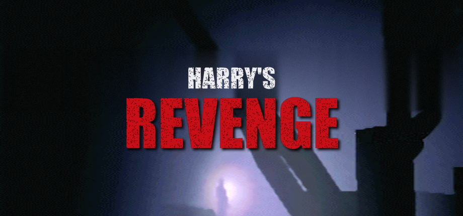
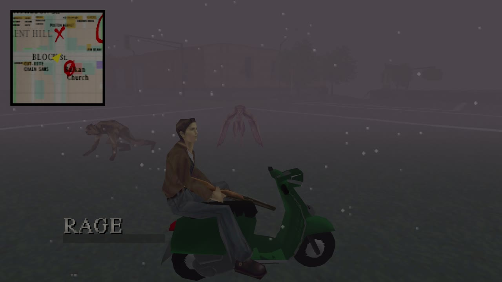
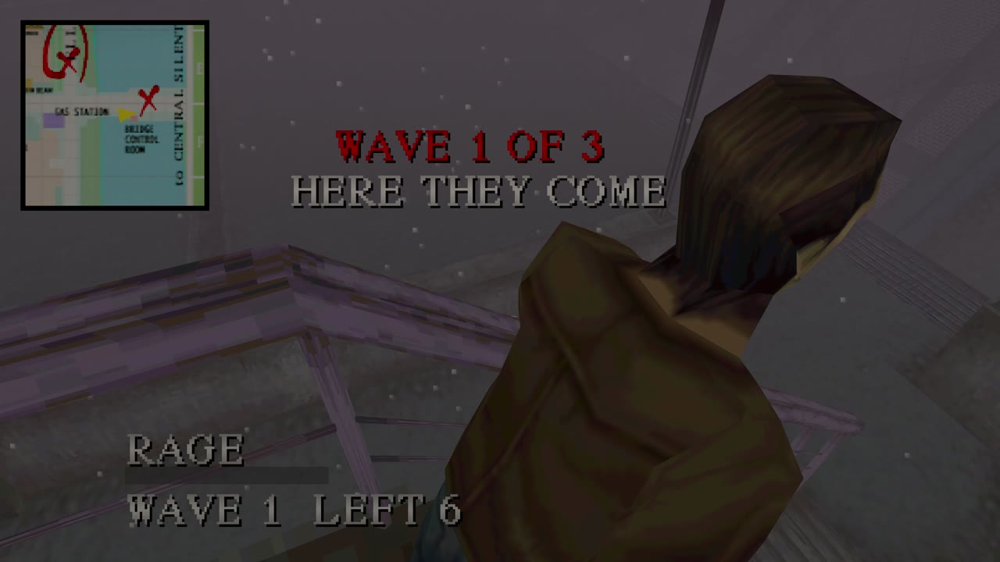
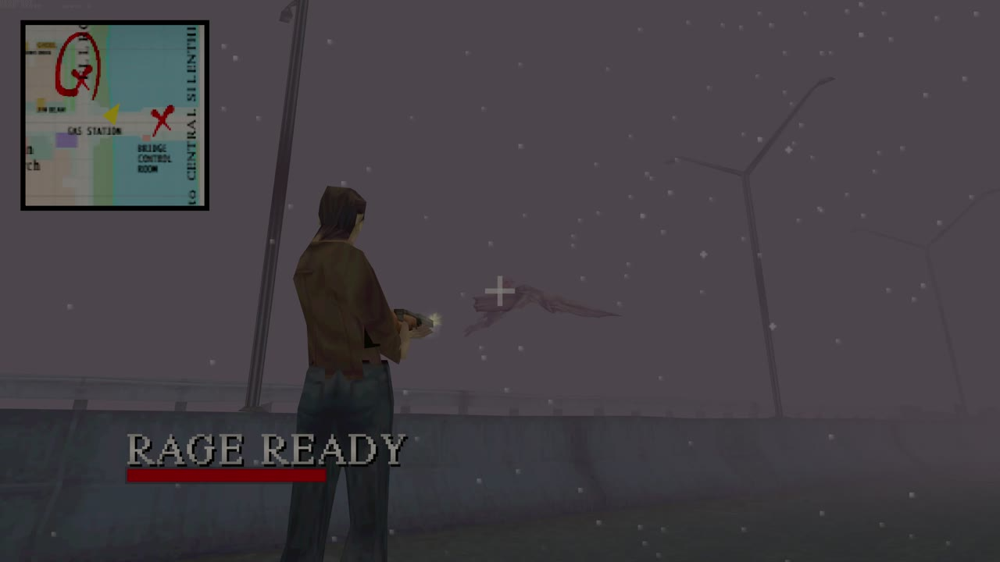
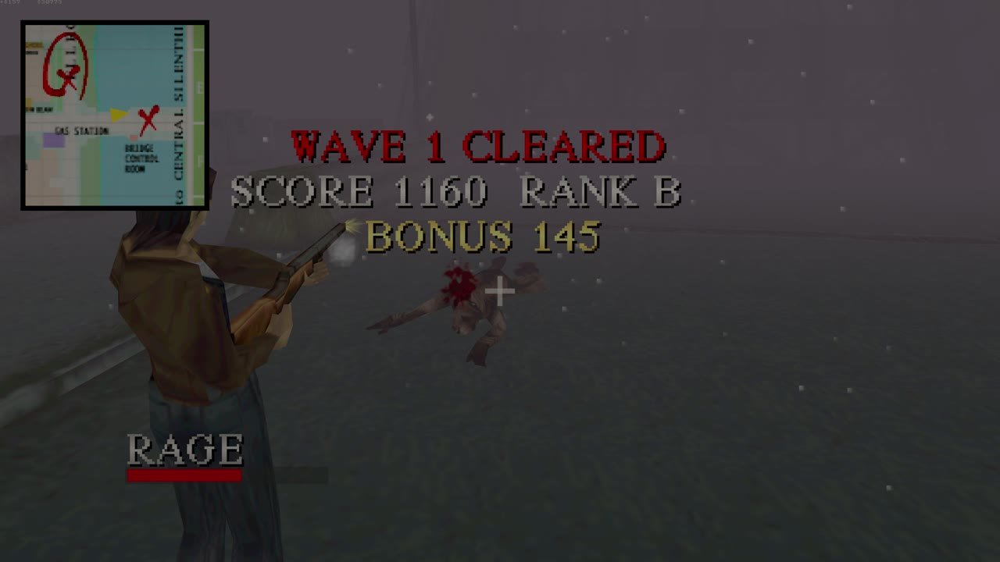

<p align="center">
  
</p>

<h3 align="center">Silent Hill (1999), but this time Harry fights back.</h3>

<p align="center">
  An action-comedy fan mod of the native <a href="https://github.com/SlickAmogus/silent-hill-decomp">Silent Hill PC port</a>.<br>
  Same town, same fog, same story. Much bigger guns, a lot more monsters, and a lead who will not stop talking.
</p>

---

In the original game Harry Mason is a novelist with a handgun and a bad feeling. In **Harry's Revenge** he is still a novelist, but now he hits back: monsters pour out of the fog in waves, kills pay cash, a creepy merchant sells shotguns and chainsaws, a rage meter turns the world to slow motion, and Harry narrates the whole thing like an action hero who has had a very long day. There is also a scooter.

<p align="center">
  
  
  
  
</p>

## What's new

**Harry fights back**
- Hits harder, takes less damage and heals between fights (all tunable).
- Head shots do double damage; head and leg shots, the shotgun, the rifle and melee **stagger** monsters, and a staggered monster can be **kicked**.
- **Rage meter:** kills and head shots fill it. Unleash it and the world slows to half speed while Harry keeps his pace, deals triple damage and takes none, to the announcer's *"Harry's... REVENGE!"*
- **Kill streaks:** *Double kill! Triple kill! Rampage! Unstoppable!* with cash bonuses.

**More monsters**
- Every natural spawn brings friends, and some of them are **invaders** from other parts of the game (nurses in the street, anyone?).
- **Waves:** where an area has monsters, they come out of the fog in three escalating waves with rest between them. Each cleared wave is scored (kills, head shots, speed, damage taken) and ranked **S / A / B / C**; clear the third and the area stays quiet for the session.
- Kills drop ammo for the guns Harry carries.

**Money, a merchant and upgrades**
- Kills pay cash. A sly merchant (*"What're you buyin', stranger?"*) appears when the coast is clear and sells ammo, health, the late-game weapons from the start (chainsaw, katana, rock drill, even the HyperBlaster), and five levels of **damage, clip size and reload speed** per gun.
- Money and upgrades are saved inside your normal save file.

**A scooter**
- Found parked the first time you step into the open streets. Double-tap Run to hop on, ride at 2.5x speed with a motorbike engine under you, and Harry sits on it properly.

**A whole new voice**
- **The story is redubbed** as a buddy-cop action comedy: all 620 cutscene lines rewritten (597 re-voiced, the rest are gasps and screams) with matching subtitles, from *"Cheryl? Sweetie, Daddy's cardio is terrible!"* onwards.
- **330 new voice lines:** kill quips, pickup quips for every key and weapon, a line for every location, complaints about running, rage roars, comebacks.
- **A villain on the radio** (*"Oh, Harry. You're hardly Alan Wake."*). Harry answers back.
- **Optional salty language** (mild, and it can be switched off).
- **Combat music:** four tracks (industrial metal, darksynth, horror punk, drum and bass) that kick in when monsters close in.
- A new title screen.

Everything above is optional. Set `revenge_mode = 0` in `config.cfg` and you are back to the port's faithful Silent Hill.

## You need your own copy of the game

**No game data is included.** Silent Hill is © Konami. You need a legally obtained PlayStation disc image (the USA release, SLUS-00707, is the one this mod is tested with), exactly as for the [original port](docs/UPSTREAM_README.md). Harry's Revenge reads everything else, including the cafe animation it sits Harry on the scooter with, straight from your disc at run time.

## Building and playing

Harry's Revenge builds exactly like the port it is based on. See **[Building](docs/UPSTREAM_README.md#building)** in the original README for prerequisites.

```sh
cd pc_port
./build.sh            # Windows (MSYS2/MinGW), Linux, macOS (Homebrew)
```

Then put your disc image in `pc_port/build/gamedata/` and run `pc_port/build/SilentHillPC`. The build copies everything the mod adds (voices, music, title screen, subtitles) next to the executable.

It has been played on a Steam Machine (SteamOS, built in an Ubuntu 22.04 container) and on an Apple Silicon Mac, which also needed a few fixes to the port that are [upstream now](https://github.com/SlickAmogus/silent-hill-decomp/pull/158).

## Controls

On top of the port's own [controls](docs/UPSTREAM_README.md#controls) (the mod defaults to the third-person shooter camera):

| | Controller | Keyboard |
|---|---|---|
| Merchant (no monsters nearby) | R1 | M |
| Unleash rage (when the bar flashes) | Square / X | G |
| Hop on / off the scooter (open streets) | double-tap Run (L1) | B |
| Kick a staggered monster | attack, unaimed, up close | |

All of these can be rebound in `config.cfg` (`key_merchant`, `pad_merchant`, `key_rage`, `pad_rage`, `key_scooter`).

## Tuning

Every part of the mod is a `revenge_*` key in `config.cfg`, documented there. The ones you are most likely to touch:

| Key | Default | |
|---|---|---|
| `revenge_mode` | `1` | `0` turns the whole mod off |
| `revenge_weapon_damage` / `revenge_damage_taken` | `175` / `50` | percent |
| `revenge_enemies` | `3` | monsters per natural spawn |
| `revenge_waves` / `revenge_rest` / `revenge_horde` | `3` / `300` / `10` | waves per area, seconds between waves, most alive at once |
| `revenge_invaders` | `35` | percent of extra monsters from other areas |
| `revenge_swearing` | `1` | `0` keeps Harry clean |
| `revenge_music` | `40` | combat music volume, `0` = off |
| `revenge_scooter_speed` | `250` | percent of Harry's run |
| `language` | `en_revenge` | `auto` for the original subtitles |

## How it's built

The mod lives alongside the port in a handful of files, each hooked into the game with small `#ifdef SH_PC_PORT` calls:

| File | What it does |
|---|---|
| [`pc_revenge.c`](pc_port/src/pc_revenge.c) | damage, staggers, spawn clones and invaders, ammo drops, all of Harry's voice lines |
| [`pc_waves.c`](pc_port/src/pc_waves.c) | waves, rest, scoring and ranks, cleared areas |
| [`pc_rage.c`](pc_port/src/pc_rage.c) | rage meter and slow motion, kill streaks, the voice on the radio |
| [`pc_merchant.c`](pc_port/src/pc_merchant.c) | money, the shop and upgrades (stored in spare bytes of the save) |
| [`pc_scooter.c`](pc_port/src/pc_scooter.c) | the scooter: parking, riding, drawing the model, the seated pose and the engine |
| [`pc_music.c`](pc_port/src/pc_music.c) | combat music, ducking the game's own BGM |

The audio, story rewrite, title art and scooter model are generated by the scripts in [`pc_port/tools/revenge/`](pc_port/tools/revenge/).

## Credits

- **The Silent Hill PC port** by [SlickAmogus / KushAstronaut](https://github.com/SlickAmogus/silent-hill-decomp) and contributors, built on the [Silent Hill decompilation](https://github.com/shdecompilations/silent-hill-decomp) and [PsyCross](https://github.com/SlickAmogus/PsyCross). Harry's Revenge is a fork of their work; their original README is [here](docs/UPSTREAM_README.md).
- **Scooter model:** ["Low-Poly scooter"](https://skfb.ly/oIXJA) by supakorn.pim, [CC BY 4.0](http://creativecommons.org/licenses/by/4.0/) (display base removed, recoloured).
- **Voices, music and sound effects** generated with [ElevenLabs](https://elevenlabs.io) (Eleven v4, Eleven Music, sound effects) using stock voices; no original cast members' voices were cloned or imitated.
- **Silent Hill** is © Konami. This is an unofficial, non-commercial fan project, not affiliated with or endorsed by Konami.
- Made with [Claude Code](https://claude.com/claude-code).

## Licence

Same terms as the port: the port and this mod's code are **GPL-3.0** ([LICENSE](LICENSE)); the decompiled sources remain the work of the decompilation contributors and are not licensed by this project. See [COPYRIGHT.md](COPYRIGHT.md) for the full breakdown.
